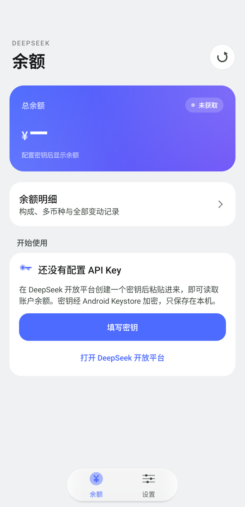
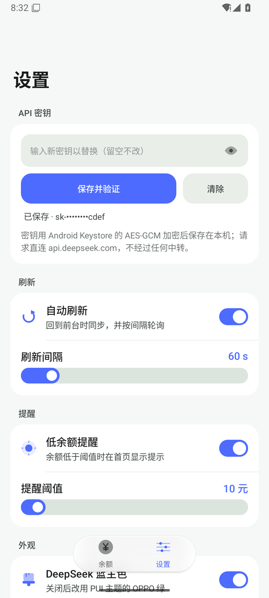
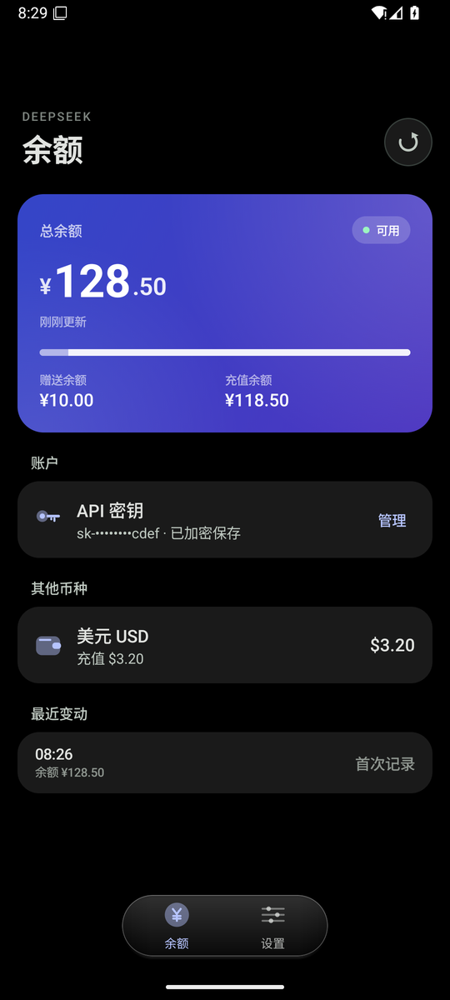
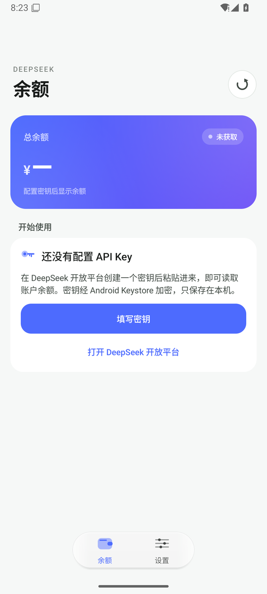
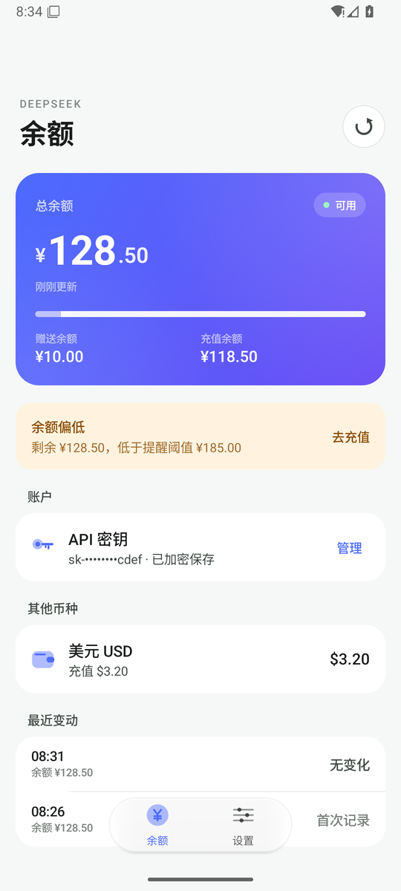
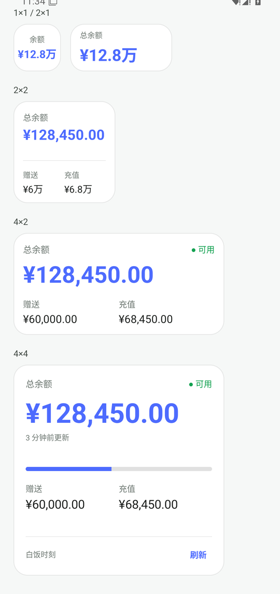
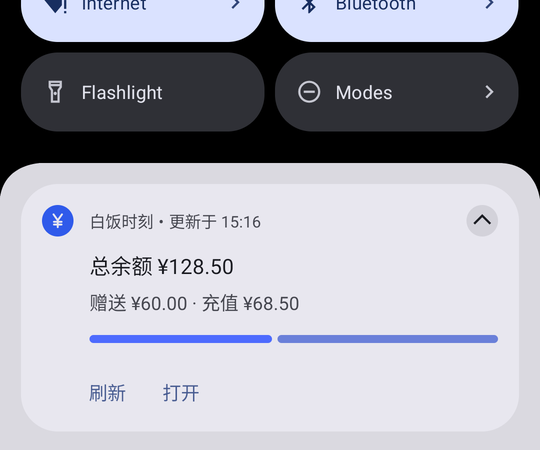
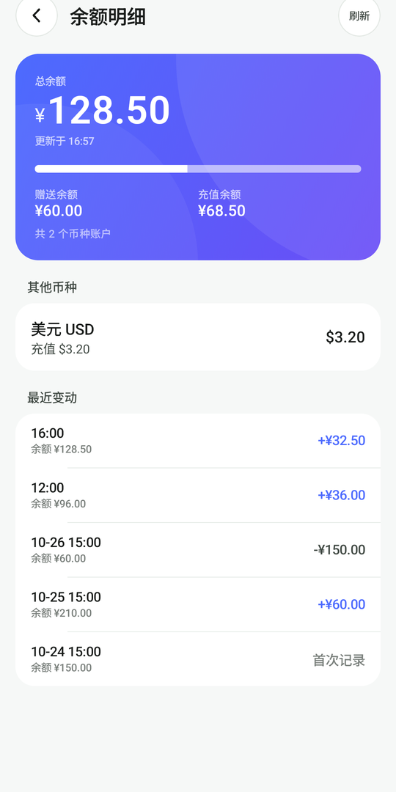

# 白饭时刻（PuiBalance）

我懒，这是大肥鱼写的README.md

应用名「白饭时刻」，用 DeepSeek 的 API Key 直接查账户余额的 Android 应用。界面基于 **PUI 主题库**（Compose）：
浅灰底（`#F0F1F3`）+ 纯白卡片（`#FFFFFF`）+ 20dp 圆角 + 克制字阶，强调色默认换成 DeepSeek 蓝。

- 包名：`com.panl.balance`
- 版本：`4.16`（versionCode 47）
- 产物：`白饭时刻-4.16.apk`（8.5 MB，已签名可直接安装）
- 成品包下载：[Releases · 最新版本](https://github.com/sakurakingfifth-debug/White-Rice-Time/releases/latest)
- 编译基准：Kotlin 2.2.10 / Compose 1.10.4 / Material3 1.4.0 / AGP 9.2.1 / Gradle 9.4.1 / compileSdk 37 / minSdk 26

## 截图

| 余额（浅色） | 设置 | 余额（深色） |
|---|---|---|
|  |  |  |

| 未配置密钥 | 低余额提醒 |
|---|---|
|  |  |

| 桌面插件：1×1 / 2×1 / 2×2 / 4×2 / 4×4 |
|---|
|  |

| 通知：实时更新（置顶）+ 普通余额通知 |
|---|
|  |

| 余额明细（卡片放大进入） |
|---|
|  |

| 应用图标（自适应 / 圆形裁切） |
|---|
|  |

> 截图为 Android 16 模拟器实拍，金额是演示数据。

## 图标

原图是带「Deepseek」文字条和自带圆角的方图，按 Android 图标规范重做：

| 项 | 做法 |
|---|---|
| 文字条 | 裁掉。图标在 48dp 下文字不可读，且「Deepseek」与 App 名「白饭时刻」不一致 |
| 自带圆角 | 裁掉。圆角由启动器的遮罩决定，图标本身必须整幅出血 |
| 自适应图标 | 108dp 两层：背景层放整幅插画，**不设前景层**（插画已铺满，加前景反而会在部分启动器的视差动画里露边） |
| 安全区 | 插画缩到 **86%**，系统按 72dp 裁切后正好保住下巴、领口与剪刀手；再满就会被切 |
| 单色层 | ¥ 矢量撑满 66dp，供 Android 13+ 主题图标（壁纸取色）使用 |
| 密度 | mdpi 108 / hdpi 162 / xhdpi 216 / xxhdpi 324 / xxxhdpi 432，用 WebP q92（PNG 共 700 KB，WebP 只有 103 KB） |
| 圆形图标 | `ic_launcher_round` 单独指向同一套自适应配置，清单 `android:roundIcon` 已切过去 |

---

## 一、功能

| 能力 | 说明 |
|---|---|
| 余额总览 | 总余额大号展示，拆分「赠送 / 充值」，并用构成条显示两者比例 |
| 多币种 | `balance_infos[]` 返回多种币种时，主卡取人民币，其余在「其他币种」分组列出 |
| 账户状态 | `is_available` 映射为「可用 / 不可用」胶囊标签 |
| 密钥管理 | 输入、显示/隐藏、保存并验证、清除；只保存本机 |
| 自动刷新 | 回到前台时同步（30 秒内不重复请求），前台按 30–300 秒间隔轮询 |
| 后台常驻 | 可选开关：用 `specialUse` 前台服务在锁屏后按同一间隔同步，通知、插件与余额一起保持最新 |
| 低余额提醒 | 阈值 1–200 元，低于阈值时首页显示琥珀色提示条，可直达充值页 |
| 余额变动 | 每次变化记一条（最多 30 条），显示时间、余额与差额 |
| 错误分类 | 401 密钥无效 / 402 余额不足 / 429 限流 / 5xx 服务异常 / 超时 / DNS / TLS 分别给文案 |
| 外观 | 跟随系统深色模式；DeepSeek 蓝与 PUI Themed 主题色可切换；图标可选跟随壁纸取色 |
| 余额明细 | 从首页卡片放大进入的独立页面：构成、多币种、全部变动记录；ColorOS 16.1+ 上走系统无缝动画 |
| 桌面插件 | 1×1 / 2×1 / 2×2 / 4×2 / 4×4 五种余额尺寸，显示余额、构成、状态，30 分钟自动同步；另有一个 4×2「鲸元卷」纯图片插件 |
| 通知 | 实时更新（Android 16+ 状态栏胶囊 / 锁屏置顶）与余额通知（常驻、滑不走），可分别开关；ColorOS 16 上实时更新显示为流体云 |
| 控制中心磁贴 | 饭碗图标 + 余额（精确到分），点一下打开应用；设置页可一键添加到控制中心（Android 13+） |
| 高低峰判断 | 按北京时间判断 DeepSeek 高峰 / 低峰（工作日 9–12、14–18 为高峰，其余时段单价 5 折）：主卡角标 + 用量卡里「距切换还有多久」 |

---

## 二、界面结构

两页 + 悬浮胶囊导航栏，顶部是 AGSL 逐像素渐变模糊（越靠顶越糊）：

1. **余额**：页标题 → 品牌渐变主卡（金额 / 可用状态 + 高低峰角标 / 构成条 / 赠送与充值）→ 错误提示 → 低余额提示 →
   余额明细入口 → **用量统计**（今日消耗 / 近 7 天 / 7 天柱状图 / 高低峰提示）→ 账户密钥摘要 → 其他币种 → 最近变动
2. **设置**：API 密钥（输入 + 保存并验证 + 清除）→ 刷新策略 → 后台常驻 → 提醒 → 通知 → 控制中心 → 外观 → 数据 → 关于

首次启动没有密钥时，首页显示引导卡，点「填写密钥」会切到设置页并自动聚焦输入框。

### 高低峰判断

`data/PeakHours.kt`，纯本地计算，不请求任何接口：

- 官方口径：**北京时间、周一至周五 09:00–12:00 与 14:00–18:00 为高峰**，其余时段（含周末全天）为空闲，
  空闲单价是高峰的一半；
- 时区固定用 `Asia/Shanghai`，不跟设备时区走（人出差到别的时区也按官方时间算）；
- `nextSwitch()` 找下一次切换时刻，主卡角标与用量卡里的「距低峰 / 距高峰 X 小时 Y 分」都由它算；
- 页面停留时每 30 秒重算一次，跨过 9:00 / 12:00 这类边界角标会自己翻过来；
- **已知近似**：法定节假日官方算空闲，但节假日表每年公布，这里没有内置 —— 节假日会判成高峰，
  只影响文案，不影响任何计费。

---

## 三、桌面插件

五种尺寸共用一套渲染逻辑（`widget/BalanceWidgets.kt`），区别只在布局与信息密度：

| 尺寸 | 内容 | 布局 |
|---|---|---|
| 1×1 | 余额（紧凑格式，过万显示「万」） | `widget_1x1.xml` |
| 2×1 | 总余额 + 金额 | `widget_2x1.xml` |
| 2×2 | 金额 + 赠送 / 充值 | `widget_2x2.xml` |
| 4×2 | 金额 + 可用状态 + 赠送 / 充值 | `widget_4x2.xml` |
| 4×4 | 金额 + 更新时间 + 构成条 + 赠送 / 充值 + 手动刷新 | `widget_4x4.xml` |

数据与刷新：

- 先用 `Prefs.lastSnapshot` 缓存秒开，再在 `goAsync()` 里发一次请求（5s 连接 / 7s 读取，9s 总超时），成功后回写并重绘；
- 系统每 30 分钟回调一次 `onUpdate`（`updatePeriodMillis=1800000`），4×4 右下角可手动刷新；
- 应用内余额、密钥、强调色变化时会立刻同步所有已放置的插件；
- 金额用 `autoSizeTextType` 自动缩放，避免长数字被截断；
- 深色模式使用浅一档的品牌色（`#9FB2FF` / `#5ADB9A`），保证在 `#1A1A1A` 卡片上的对比度。

点击插件打开应用；RemoteViews 不支持 `setProgressTintList`，构成条因此准备了蓝 / 绿两套 drawable 按强调色切换。

### 鲸元卷 4×2（纯图片）

另一个独立插件 `widget/BanknoteWidgetProvider.kt`，只展示一张插画，不显示余额、不刷新、不响应点击：

| 项 | 做法 |
|---|---|
| 图片 | `res/drawable-nodpi/widget_banknote.jpg`（1080×540，2:1，228 KB）——放 `nodpi` 避免被密度缩放，`centerCrop` 保证任何格子比例都铺满不变形 |
| 刷新 | `updatePeriodMillis="0"`，系统不唤醒应用；`onUpdate` 只 `updateAppWidget` 挂布局 |
| 点击 | 不设 `setOnClickPendingIntent`，点了没有任何副作用（需求就是「只展示这张图」） |
| 预览 | `previewImage` 用同一张图，选插件时直接看到成品 |

---

## 四、通知

设置 → 通知 里有两个独立开关，默认都关闭；首次开启会申请 `POST_NOTIFICATIONS`。

| 类型 | 形态 | 内容 |
|---|---|---|
| 实时更新 | Android 16+ 按 Live Updates 规范发布：`ProgressStyle` + `EXTRA_REQUEST_PROMOTED_ONGOING` + `setShortCriticalText`，由系统提升为状态栏胶囊 / 锁屏置顶卡片；低版本退化为带进度条的常驻通知；ColorOS 16 上渲染为流体云 | 标题「总余额 ¥128.50」、正文「赠送 ¥60.00 · 充值 ¥68.50」、两段式构成条、刷新 / 打开 |
| 余额通知 | 常驻通知（渠道 LOW，静默，`setOngoing(true)`，**滑不走**） | 展开显示余额、赠送 / 充值、更新时间，带刷新动作 |
| 后台同步 | 前台服务通知（渠道 LOW，静默，常驻），只在「后台常驻」开关打开时存在 | 「总余额 ¥128.50」+「后台同步中 · 每 60 秒更新」+ 更新时间，带刷新 / 停止 |

实现要点：

- 清单声明 `POST_NOTIFICATIONS`（运行时）与 `POST_PROMOTED_NOTIFICATIONS`（普通权限，实时更新必需）；
- 渠道 `balance_live` 重要性 DEFAULT（Live Updates 不允许 `IMPORTANCE_MIN`），`balance_normal` / `balance_service` 为 LOW；
- 平台 `Notification.Builder` 没有 `setRequestPromotedOngoing`（那是 Compat 的方法），平台侧用 `EXTRA_REQUEST_PROMOTED_ONGOING` 请求提升；
- 余额通知是**常驻**的：`setOngoing(true)` + 不带 `setAutoCancel`，用户滑不走，只能到设置里关开关（或清空密钥）—— 想临时收起就关掉它，不想被常驻打扰就别开；
- 三条通知互相独立，一条构造失败不影响其他；通知上的「刷新」走 `NotificationActionReceiver`，在 `goAsync()` 里拉一次数据后重绘通知与插件；
- 数据、密钥、强调色变化即时重绘；回到前台与开机（`BOOT_COMPLETED`）用缓存补回，避免进程被回收后通知消失；
- 状态栏胶囊文字按流体云规范收到 5 字内（`¥128` / `¥1235` / `¥13万` / `¥1.3亿`），空间不足时系统只显示 ¥ 图标。

### 后台常驻（前台服务）

设置 → 后台 → 「允许一直在后台运行」。打开后会拉起 `BalanceWatchService`：

| 项 | 做法 |
|---|---|
| 服务类型 | `foregroundServiceType="specialUse"`，清单里用 `PROPERTY_SPECIAL_USE_FGS_SUBTYPE` 说明用途，并声明 `FOREGROUND_SERVICE` / `FOREGROUND_SERVICE_SPECIAL_USE` |
| 为什么不用 `dataSync` | Android 15 起 `dataSync` 前台服务 24 小时内累计只能跑 6 小时，到点被系统强停；`specialUse` 没有时间上限 |
| 循环 | 进服务先对齐一次缓存（30 秒内不重复请求），之后每轮重读 `intervalSec` 再 `delay` —— 设置页拖滑杆立刻生效 |
| 每轮做什么 | 拉一次余额 → 落盘 → 重绘两条可选通知 → 刷新服务自己的通知 → 更新所有桌面插件 |
| 停止 | 设置页关开关、通知上的「停止」动作、清空密钥、或系统回收后 `START_STICKY` 重启（重启时重新校验开关与密钥） |
| 开机 | `BOOT_COMPLETED` 里若开关为开就重新拉起服务（`specialUse` 允许从开机广播启动） |

**ColorOS / 欧加系机型上的那个弹窗**：「要允许应用一直在后台运行吗？允许『白饭时刻』始终在后台运行可能会缩短电池续航时间」是**系统**在第三方应用首次拉起前台服务时弹出的确认框，应用侧无法伪造也不需要伪造 —— 点「允许」服务才能长期存活，点「拒绝」则后台同步会被系统掐断（开关仍显示为开，但数据只在回到前台时更新）。日后可在「设置 → 应用 → 白饭时刻 → 耗电管理 / 后台运行」里改。

代价与取舍：

- 通知栏必然多一条常驻通知（Android 对前台服务的硬性要求），所以让它顺带显示余额，而不是放一条无信息量的「正在运行」；
- 前台服务让进程保持 active，锁屏后网络与定时器不会被冻结，但耗电与流量随间隔线性增长 —— 间隔默认 60 秒，建议 120 秒以上；
- 应用在前台时界面自己的轮询仍在跑，两者会各发一次请求（同一份数据，仅多一次 API 调用），换来的是界面状态与后台数据互不依赖。

### ColorOS 流体云

ColorOS 16 把 Android 16 的实时更新渲染成**流体云**（气泡 / 状态栏胶囊 / 展开面板）。本应用按流体云模板规范（[id=12658](https://open.oppomobile.com/documentation/page/info?id=12658)）收敛了通知的文案与结构：

| 流体云位置 | level | 本应用填的内容 |
|---|---|---|
| 胶囊左侧 | `A*` + `B*` | 服务图标 + 余额，**≤5 字** |
| 胶囊右侧 | `B0` | 更新时间 |
| 面板顶部 | `D8` + `C10` | 图标 + 「更新于 HH:mm」 |
| 面板核心 | `D1` + `B1*` + `C1` | 图标 + 总余额 + 赠送 / 充值 |
| 面板底部 | `D13*` | 两段配色构成条（赠送 / 充值） |
| 面板按钮 | `E9*` / `E10*` | 刷新 / 打开 |

几条规范在实现里落成了硬约束：

- **胶囊文本 ≤5 字**：`FluidCloud.capsuleText()` 按「先精确后紧凑」挑第一个不超长的写法 —— `¥128` / `¥1235` / `¥13万` / `¥1.3亿`；货币符号也压缩（`HK$` → `$`），否则 `HK$` 一个符号就吃掉一半宽度。
- **胶囊样式不能变**：规范要求同一实时活动内信息变化时胶囊样式保持一致，所以没有数据时也给一条满格中性构成条，不让进度条时有时无。
- **构成条两段配色**：赠送用品牌色、充值用同色系浅一档；关闭「DeepSeek 蓝」时整套换 PUI 绿。
- **按钮固定两个**：刷新走广播 + `goAsync()`，打开直达余额页（`puibalance://balance`）。

设置页不再展示流体云状态行——适配是静默生效的，用户看到的就是通知本身；设备/系统判断仍在 `FluidCloud` 里，只用于胶囊文案与降级逻辑。

#### 为什么没有直接接泛在服务 SDK

流体云的完整形态（气泡、大胶囊、AOD、外屏、手表、耳机播报）要走**泛在服务卡片**：`.oml` 模板打包成 UPK → 向 OPPO 申请泛在卡片服务 → UPK 由 OPPO 云端下发 → 接入 `SeedlingSupportSDK`（`com.oplus.pantanal.card:seedling-support-*`）提供数据。这条链路需要 OPPO 侧授权与云端发布，个人应用无法自行上线自测。

所以本仓库的做法是：

- App 内走标准的 Android 16 Live Updates，ColorOS 16 上同样显示为流体云；
- 按规范写好的卡片源码放在 [`fluidcloud/`](fluidcloud/)，申请通过后可直接复用（`pages/index.oml` + 字段映射说明）。

> 说明：Google 对 Live Updates 的定位是「用户主动发起、有明确起止的进行中活动」，余额监控属于边缘用法，上架 Play 可能不被推荐；本地自用不受影响。

### 控制中心磁贴

`qs/BalanceTileService.kt`，磁贴图标是 PUI 风格的饭碗（`res/drawable/ic_tile_bowl.xml`）：
碗身与碗沿实心、米饭用 45% alpha 作辅助形，24dp 网格、留 10% 安全边距 —— 和 `PuiIcon` 的构造规则一致。
系统会给磁贴图标整体着色，双色靠 alpha 表现，所以不需要额外的 tint。

| 项 | 做法 |
|---|---|
| 金额 | 放在 **`Tile.label`** 里（`¥1,234.50`，`Fmt.money` 固定两位小数）。磁贴下面那行字就是 label；**ColorOS / MIUI / One UI 都只渲染 label、不渲染 subtitle**，所以金额放 subtitle 的话界面上只剩「余额」两个字 |
| 副标题 | 原生 Android（Pixel）会在 label 下面再显示 `subtitle`，那里放「余额」说明这个数字是什么 |
| 状态 | 有余额时 `STATE_ACTIVE`（点亮），没密钥 / 没数据时 `STATE_INACTIVE`（置灰），label 显示「未配置密钥」/「尚未同步」 |
| 点击 | 打开应用；锁屏下拉时先 `unlockAndRun`，Android 14+ 用 `startActivityAndCollapse(PendingIntent)`（旧重载已废弃） |
| 刷新 | 数据变化后调 `TileService.requestListeningState` 让系统重新回调 `onStartListening`；入口统一在 `BalanceNotifications.sync()` 里踢一下，磁贴没放上去时是空操作 |
| 添加 | 设置 → 控制中心 → 「添加到控制中心」，走 Android 13+ 的 `StatusBarManager.requestAddTileService`；低版本给的是手动添加的提示 |

---

## 五、ColorOS 无缝动画

ColorOS 的「View 无缝动画」把一张卡片放大成全屏 Activity，返回时再缩回原卡片，走系统级 Spring，
支持跟手阻断与回弹——比 `overridePendingTransition`（只能播固定 XML）和共享元素动画（不支持 Spring）都更顺。

- 能力介绍：https://open.oppomobile.com/documentation/page/info?id=13771
- 接入文档：https://open.oppomobile.com/documentation/page/info?id=13772

**落地位置**：首页「余额明细」卡 → `DetailActivity`。

### 为什么用反射而不是 `compileOnly` AAR

文档给的接法是 `compileOnly "com.oplus.animation:viewseamless:1.0.0@aar"`——只编译期可见，实现由系统提供。
这里改成反射（`anim/SeamlessView.kt`），原因：

1. 非 OPPO 机型、ColorOS 16.1 以下没有这个类，直接引用会 `NoClassDefFoundError`；打进 APK 又白增重；
2. 文档明确要求自行兜住 `RuntimeException` / `NoSuchMethodError`，反射正好能把 `ClassNotFoundException` 一并吃掉，
   失败时安静退化成普通 `startActivity`。

常量（`VIEW_SEAMLESS_OPEN` / `BUNDLE_RADIUS` / `BUNDLE_COLOR` / `OS_16_0_BASE`）也在运行时从类里读，
不硬编码字符串——SDK 换版本时不会悄悄失效。

### 关键实现

- **源 View 从哪来**：Compose 整棵树只有一个 View，所以「余额明细」卡用 `AndroidView` 套一层 `ComposeView`
  （`ui/SeamlessEntryCard.kt`）——样式仍是 Compose 画的，但在系统看来它就是一张能放大的卡片；
- **圆角必须传**：卡片 20dp，`BUNDLE_RADIUS` 传 `20 * density`，否则起止形状对不上；
- **补边色**：`BUNDLE_COLOR` 传卡片的 `surfaceContainerLowest`，系统取色失败时兜底；
- **卡片区域**（4.9）：`BUNDLE_RECT` 传 `getGlobalVisibleRect()` 的结果，框架自己算的时候列表滚动 /
  遮挡都可能偏，传一份更稳；
- **上下遮挡比例**（4.9）：`BUNDLE_LIST_COVER` 传 `float[]{顶部渐隐占比, 导航栏占比}`。
  卡片被顶部渐隐或悬浮导航栏遮住时，动画末端会做 alpha 渐隐，而不是硬缩到被挡住的位置；
  比例由 `BalancePage` 用 `blurHeight` 和「16dp + 56dp 导航栏 + 导航栏 inset」算出来；
- **调用时机**：`setSeamlessView` 必须在 `startActivity` 之前，返回时不用再调，系统自己配对；
- **其他可用接口**（4.9 起记在 `SeamlessView` 的文档注释里，暂未用到）：
  `finishCurrentAnimation()` 提前结束动画、`skipBackAnim(activity)` 只做打开不做返回、
  `setSkipViewSeamless(activity)` 返回改走默认横切、`setForceLeashAlphaOut(activity, force)` 强制淡出；
- **动画结束后不要重建源 View**（4.10 已去掉 4.0 的做法）：`ON_RESUME` 可能正好落在返回动画
  中间，销毁旧 `ComposeView` 会让系统退回默认淡出。遮挡问题改用 `BUNDLE_LIST_COVER` 解决；
- **限制**：ColorOS 16.1+、动效等级 B+ 及以上（`persist.sys.oplus.anim_level <= 3`）；
  浮窗 / 兼容模式 / 平行视窗 / 分屏下不生效，代码里都做了判断。

### 踩过的坑（1.8 在 ColorOS 17 上完全没有动画）

1. **类名猜错**：按 Gradle 坐标 `com.oplus.animation:viewseamless` 推测类名是
   `com.oplus.animation.viewseamless.OplusViewSeamless`，实际是 **`com.oplus.animation.OplusViewSeamless`**。
   `Class.forName` 直接抛异常，被静默降级吃掉，表现就是「点了没动画、也不报错」。
2. **Maven Central 上的 AAR 是空实现**：`com.oplus.animation:viewseamless:1.0.0` 能下到，
   但反编译后 `setSeamlessView` 只有一句 `return false`，`getVersion()` 返回 `-1`。
   它只用于编译期对齐签名，**绝不能打进 APK**——否则会遮蔽系统的真实实现。
3. 因此 `getVersion()` 返回 `-1` 时不能当成「版本过低」跳过，要照常调用，让系统实现自己决定。

现在的做法：类名两个候选都试、常量值带反编译得到的兜底（`view_seamless_open` 等）、
方法按签名匹配、版本号 `< 0` 视为未知继续调用。

### 预测性手势返回

Android 13 起支持预测性返回，14 起提供逐帧进度回调。这里把手势进度直接喂给页面形变，
让「手势返回」和「无缝动画」落点一致：

- 清单 `android:enableOnBackInvokedCallback="false"`，`DetailActivity` **不注册任何返回回调**：
  预测性返回在 ColorOS 上和无缝转场互相打架（自绘 → 双重收缩/重影；注册不画 → 没有反馈），
  所以直接关掉。返回 = 系统默认 finish，关闭动画就是 `SeamlessView` 配好的「缩回卡片」；
- 卡片的屏幕矩形与圆角仍通过 Intent 传过去，供调试与后续使用；
- API 33 没有进度回调，退化成普通返回；API 32 及以下走系统默认。

#### 五个真实踩到的坑

1. **`Animatable.animateTo` 崩在缺帧时钟**（2.2）：回调里用 `lifecycleScope.launch { animateTo(...) }`，
   抛 `IllegalStateException: A MonotonicFrameClock is not available in this CoroutineContext`。
   撤回时进程直接挂掉，用户看到的就是「划回来一松手，页面没了」。
   修法：协程改用 `lifecycleScope.launch(AndroidUiDispatcher.Main)`——这个 dispatcher 自带 Compose 帧时钟。
2. **`BackEvent.progress` 在 ColorOS 上恒为 0**：`started`/`progressed` 都来了，`progress` 一直是 `0.0`。
   2.2 的修法是改用 `touchX / 半屏宽` 换算——**这个修法本身是错的**，见第 3 条。
3. **`touchX` 是屏幕绝对坐标，不能直接当进度用**（2.5 修）：返回手势从屏幕边缘起手，
   `touchX` 起点就在边缘。右边缘起手时 `touchX / 540 ≈ 2.0`，被 `coerceIn` 夹成 **1**，
   于是**手势刚开始页面就瞬间缩到底**；手指越往左划 `touchX` 越小，进度反而往回走，页面又慢慢长回来；
   松手弹回。逐帧量测这段录屏（1080×2354，14s）得到的主卡宽度轨迹是
   `490 → 342 → 490 → 342…`（490 = 进度 0，342 = 进度 1）在 0 和 1 之间反复跳，正是这个原因。
   修法：`|touchX - 起手位置| / (0.35 × 屏宽)`，左右两侧起手都从 0 开始、单调跟手；
   同时只要收到过一次真实 `progress` 就优先用它，两套算法不混用。
4. **提交时自己补动画会和无缝动画「缩两次」**（3.3 修）：ColorOS 的无缝动画是 `setSeamlessView`
   配的窗口转场，`overrideActivityTransition(CLOSE, 0, 0)` **拦不住它**。2.x/3.0 的写法是先把
   内容缩到 0.7 再 `finish()`，于是「内容缩一次 + 窗口再缩一次」，卡片里会叠着一个缩小版页面
   （录屏逐帧可见：窗口已缩到卡片、里面还套着一个 0.7 的页面）。
   修法：`onBackInvoked` 里直接 `finish()`，把手势预览也收小到 8%（预览越大，两段动画越打架）。
5. **打断回弹时不能把进度清零**（3.3 修）：弹簧回弹到一半再抓住，`onBackStarted` 里若直接
   `p = 0`，页面会「啪」地跳回全屏 —— 就是用户看到的闪现。现在记住抓取时的进度 `progressBase`，
   新手势从它接着算，并且位移带方向（`dragSign`），反向拖也能正确回退。

松手的判定也跟着改了：以前比较 `lastTouchX < 8% 屏宽`（右边缘起手时 `touchX ≈ 1000`，永远不成立 →
撤回也会退出）；现在比较**进度**，`< 0.15` 就当作撤回（弹回、不 finish）。

实测（Android 16 模拟器，手势导航）：
- 拖到 420px：页面缩到 ~0.7 并跟手；
- 拖到 600px 再划回 20px 松手 → **留在详情页**，无崩溃；
- 拖到 600px 直接松手 → 正常回到首页，无崩溃；
- 页内返回箭头不受影响。

2.5 的修复依据是一段 ColorOS 真机录屏（1080×2354 / 14s / 60fps）。逐帧量测方式：
用 `Windows.Media` 的 `MediaPlayer + ScrubbingEnabled` 抽帧（本机没有 ffmpeg），
按紫色主卡的包围盒反推缩放与位移，就能算出每一帧的进度值 —— 比肉眼看「顺不顺」可靠得多。

### 自检

设置 → 关于 → **长按「版本」一行**，弹窗会列出：设备 / 系统 / ColorOS 版本 / 动效等级 /
SDK 类是否找到 / 实现版本 / 方法签名 / 上次点击的结果（`已请求无缝动画` 或 `系统返回 false` 及原因）。
在 ColorOS 真机上如果还是没动画，看这一屏就能定位是「类没找到」「动效等级不足」还是「场景不支持」。

（3.2 起「无缝动画」那一行不再显示在关于页里，自检入口改为长按版本行，避免把技术细节暴露给普通用户。）

### 真机验证（4.13，OnePlus PLK110 / Android 17 / ColorOS V17.0.0）

从 1.8 到 4.10 一直没在 ColorOS 真机上确认过动画是否真的在播。4.13 拿到一台 OnePlus PLK110 实测，
自检面板与系统日志同时给了答案：

| 观测项 | 结果 |
|---|---|
| SDK 类 | `com.oplus.animation.OplusViewSeamless` 找到 |
| 实现版本 | `40003` |
| 方法签名 | `View, Context, Bundle, AnimationCallback` |
| 动效等级 | `1`（满足 B+ 要求） |
| `BUNDLE_RECT` / `BUNDLE_LIST_COVER` | 两个 key 系统都提供 |
| 自检面板「上次点击」 | `已请求无缝动画（v40003）` |
| 打开动画 | `WindowManagerShell: Delegate animation for (#17) to RemoteTransition { ... debugName = View Seamless }`，随后 `OplusViewSeamlessRemoteManager: ViewSeamless Transition startAnimation, id: 17` |
| 返回动画 | 同上（id: 18） |

也就是说 4.10 回滚那两处「嫌疑」（`enableOnBackInvokedCallback` 回 `true`、去掉返回后重建源 View）
之后，**打开和返回都落在系统无缝转场上**，之前用户报的「没有无缝动画」在 ColorOS 17 上已经不复现。
过程中还能看到应用侧创建的 `seamless_view_mask` 图层，说明源 View 被系统正确接管。

---

## 六、构建

```bash
cp local.properties.example local.properties   # 改成本机 SDK 路径
export JAVA_HOME=/path/to/jdk-17-or-21
./gradlew assembleRelease
# 产物：app/build/outputs/apk/release/app-release.apk
```

- 依赖全部走 `google()` / `mavenCentral()`，无私有仓库；
- 需要 JDK 17+（我用的是 JBR 21）、Android SDK（compileSdk 37）、Gradle 9.4.1（wrapper 已带）；
- **签名密钥库不进仓库**：本地放了 `signing/pui-balance.jks`（storePassword / keyPassword 均为 `puibalance`）
  就自动签名，没有就产出一个未签名的 release 包，照样能编译。理由很直接 —— 把 jks 公开等于让别人
  也能签出「可覆盖安装」的同包名 APK，所以这个仓库只提供源码与已签名的成品包（见 Releases）。

### 16 KB 页大小适配

Android 15 起设备可以用 16 KB 内存页，Google Play 从 2025-11 起要求面向 Android 15+ 的应用
必须兼容（[官方说明](https://developer.android.com/guide/practices/page-sizes)）。
本应用**没有自己的 native 代码**，但 Compose 会带进来一个 `libandroidx.graphics.path.so`，
所以两件事都要成立：

1. **APK 里的 .so 必须是未压缩且 16 KB 对齐**（`zipalign -P 16`）；
2. **.so 内部每个 `PT_LOAD` 段的 `p_align` 必须 ≥ 16384**。

`app/build.gradle` 里显式写了 `packaging { jniLibs { useLegacyPackaging = false } }`
（AGP 8.5.1+ 默认如此，写死防止以后改配置时回退）。4.12 实测结果：

```bash
# 1) zip 对齐（build-tools 35+ 才有 -P 16）
zipalign -c -P 16 -v 4 白饭时刻-4.12.apk
#   lib/arm64-v8a/libandroidx.graphics.path.so (OK)
#   ... 4 个 ABI 全部 (OK)  →  Verification successful
#   （且 4 个 .so 在 zip 里都是 Stored，未压缩）

# 2) ELF 段对齐（读 PT_LOAD 的 p_align）
#   arm64-v8a / x86_64 / armeabi-v7a / x86 全部 align=16384 (16 KB) → PASS
```

依赖版本：`androidx.graphics:graphics-path:1.0.1`（16 KB 就绪版本，由 Compose 1.10.4 带入）。
**以后升级 Compose 或换成自带 .so 的库时，要重新跑上面两条命令**；
如果哪天引入了 C/C++ 代码，用 NDK r27+ 编译（默认 16 KB 对齐），或显式加
`-Wl,-z,max-page-size=16384`。

---

## 七、目录

```
PuiBalance/
├── app/src/main/java/com/panl/balance/
│   ├── MainActivity.kt              ← 入口，enableEdgeToEdge + setContent
│   ├── App.kt                       ← 主题 / Pager / 悬浮导航 / 前台定时刷新
│   ├── data/
│   │   ├── BalanceModels.kt         ← 快照、币种、历史、ApiError
│   │   ├── DeepSeekClient.kt        ← HttpURLConnection + org.json，无第三方网络库
│   │   ├── SecretBox.kt             ← Keystore AES-256-GCM
│   │   └── Prefs.kt                 ← 偏好、缓存、历史（SharedPreferences）
│   ├── widget/
│   │   ├── BalanceWidgets.kt        ← 5 种尺寸的 RemoteViews 渲染 + 后台同步
│   │   ├── BalanceWidgetProvider.kt ← 插件接收器基类 + 5 个子类
│   │   └── BanknoteWidgetProvider.kt ← 鲸元卷 4×2 纯图片插件（不刷新、不响应点击）
│   ├── anim/
│   │   └── SeamlessView.kt          ← ColorOS 无缝动画桥接（反射 + 降级）
│   ├── qs/
│   │   └── BalanceTileService.kt    ← 控制中心磁贴（余额 + 饭碗图标）
│   ├── notify/
│   │   ├── BalanceNotifications.kt  ← 实时更新 + 常驻余额通知 + 前台服务通知
│   │   ├── BalanceWatchService.kt   ← 后台常驻（specialUse 前台服务 + 定时同步循环）
│   │   ├── FluidCloud.kt            ← ColorOS 流体云适配（设备识别 + 胶囊文案）
│   │   ├── BalanceSync.kt           ← 通知/插件共用的拉取逻辑
│   │   ├── NotificationActionReceiver.kt ← 通知上的「刷新」/「停止后台」
│   │   └── BootReceiver.kt          ← 开机恢复通知、插件与后台服务
│   └── ui/
│       ├── DetailActivity.kt        ← 余额明细页（无缝动画的落地页）
│       ├── SeamlessEntryCard.kt     ← 明细入口卡 = 无缝动画的源 View
│       ├── BalanceViewModel.kt      ← 单一状态源
│       ├── BalancePage.kt           ← 首页
│       ├── SettingsPage.kt          ← 设置页
│       ├── HeroCard.kt              ← 主卡 / 提示条 / 引导卡
│       ├── Widgets.kt               ← 主按钮、文字链接、信息行
│       ├── Theme.kt                 ← DeepSeek 蓝 / 绿两套配色、主卡渐变
│       ├── Format.kt                ← 金额 / 时间 / 脱敏
│       └── Util.kt                  ← 打开外链
├── app/src/main/res/layout/widget_*.xml  ← 5 套插件布局 + 鲸元卷 4×2
├── app/src/main/res/xml/widget_*.xml     ← 5 份 appwidget-provider 元数据 + 鲸元卷
├── app/src/main/res/drawable-nodpi/      ← 鲸元卷插画（1080×540）
├── app/src/debug/                        ← 仅调试包：插件预览页
├── fluidcloud/                           ← 流体云卡片源码（需 OPPO 授权后启用）
├── app/src/main/java/com/panl/pui/  ← PUI 主题库源码（README 的方式 B 接入）
├── docs/                            ← 界面截图
└── signing/pui-balance.jks
```

---

## 八、接口

```
GET https://api.deepseek.com/user/balance
Authorization: Bearer sk-xxxxxxxx
```

```json
{
  "is_available": true,
  "balance_infos": [
    { "currency": "CNY", "total_balance": "110.00",
      "granted_balance": "10.00", "topped_up_balance": "100.00" }
  ]
}
```

金额是**字符串**，客户端用 `toDoubleOrNull()` 解析，同时兼容数字类型。

HTTP 错误映射：

| 状态码 | 展示文案 |
|---|---|
| 401 | 密钥无效（附服务端 `error.message`） |
| 402 | 余额不足 |
| 403 / 404 | 没有访问权限 / 接口地址不存在 |
| 429 | 请求过于频繁 |
| 5xx | DeepSeek 服务异常（HTTP xxx） |

网络层异常单独分类：`UnknownHostException` → 无法连接网络，`SocketTimeoutException` → 请求超时，
`SSLException` → 安全连接失败，其余 IO → 网络异常。

---

## 九、安全边界

1. **密钥加密**：Android Keystore 生成 AES-256-GCM 密钥（密钥不出 TEE），
   SharedPreferences 里只存 `v1:` + Base64(iv ‖ ciphertext)。Keystore 不可用时退回明文，保证功能可用。
2. **无中转**：所有请求直连 `api.deepseek.com`，应用没有自建服务端，没有统计与上报。
3. **不参与备份**：`android:allowBackup="false"`，避免密钥随云备份迁移。
4. **已知上限**：root 设备仍可从运行进程内存读到明文；卸载重装后 Keystore 条目消失，需要重新填写。

---

## 十、对 PUI 主题库的改动（仅 4 处）

按 README 的「方式 B：源码模块」接入，只做了四处向后兼容的扩展：

1. `PuiTheme` 增加可选参数 `colorScheme: ColorScheme? = null` —— 传 null 时行为与原来完全一致，
   传值时替换整套配色，字阶与形状仍走 `PuiTypography` / `PuiShapes`。
2. `PuiIcon` 增加 8 个图标（`Wallet` `Coin` `Key` `Refresh` `Eye` `EyeOff` `Settings` `Bolt`）及对应绘制分支，
   沿用 Iconsax Duotone Filled 的构造规则：纯实心、主形 100% + 辅助形 45%、24dp 网格。
3. `PuiIcon` 再补 1 个 `Code`（`</>`，GitHub 入口用）。
4. `PuiIcon` 增加 `val res: Int = 0`，让枚举能指向 Iconsax 矢量资源（见第十四节）；这处改动对
   库的既有调用完全透明 —— 不传 res 的图标行为不变。

其余组件（`PuiGroup` / `PuiSwitchRow` / `PuiSliderRow` / `PuiFloatingNavBar` / `PuiTopBlur` / `PuiHaptics`）零改动。
若日后用 AAR 替换源码，需要把这四处扩展重新补上。

---

## 十一、内存治理：公平运行内存与内存限制器

两家系统在同一个方向上加了两道闸，实现合在 `perf/MemoryGuard.kt` 一个文件里。

### 11.1 公平运行内存（HyperOS）

系统按**应用物理内存**（高优先级进程 PSS 之和，`oom_score_adj <= 200`）与**单进程 Java 堆**两个口径判定。
触达预警线发广播、触达查杀线再发一次，应用必须在 **3 秒内**通过广播带回来的 Binder 回一个结果：

| 位置 | key | 含义 | 类型 |
|---|---|---|---|
| `common` | `notifyType` | `1000` 物理内存异常 / `2000` Java 堆异常 | int |
| `common` | `notifyId` | 本次通知 ID，回传要原样带上 | int |
| `common` | `reason` | `Excessive PSS Usage` / `Excessive Java Heap Usage` | String |
| `common` | `action` | `trim`（预警）/ `kill`（查杀） | String |
| `common` | `callback` | 回传结果的 Binder | IBinder |
| `extra` | `pss` / `pssLimit` | 高优进程 PSS 实际值与上限 | int（KB） |
| `extra` | `heapSize` / `heapCapacity` | Java 堆已用与上限 | int（KB） |

回传格式是 `int notifyType` + `int notifyId` + `int result` + `Bundle extra`，事务号
`IBinder.FIRST_CALL_TRANSACTION`，单向发送；`result` 只有两种值：`0` 已正确处理（释放 / 保存），
`1` 未正确处理。超时系统按「未处理」算，照样杀。

落地要点：

- **在 `Application.onCreate` 里注册**（`PuiApp`），不能等界面起来 —— 进程刚活就被判定内存异常时也得收到；
- 注册在**独立 HandlerThread** 上（`RECEIVER_EXPORTED`，广播来自系统侧），落盘不占 UI 线程，
  也不和 1/3 个刷新请求抢 3 秒窗口；
- 广播字段少一层也不慌：拿不到 `common` 子 Bundle 时退回读顶层，`adb shell am broadcast` 因此可以直接自测；
- **预警（trim）**：本应用没有图片加载库、没有 LruCache，PSS 大头是 Compose 与图形层
  （`RenderEffect` / 纹理 / 字形缓存），应用侧改不了。所以释放动作只有一条有实际意义 ——
  **不在前台时补一次 GC**（Compose 每帧产生大量短命对象，堆里绝大多数是可回收垃圾，
  而查杀判定里「Java 堆」那一项主要吃这个）。可见时不 GC，避免掉帧；
- **查杀（kill）**：3 秒内用 `commit()` 同步落盘，存「再打开能接上」的最小集合 —— 停留页面 +
  没提交的密钥草稿（过 `SecretBox` 加密，不留明文）。`apply()` 在这里是不行的，进程一死就丢；
- 非小米机型走 `Application.onTrimMemory`，两条路径收敛到同一个 `release()`，
  自检面板里能看到最近一次是哪种。

### 11.2 内存限制器（Android 17+）

cgroup v2 的 `memory.high` 软限额。越过之后内核先逐出干净文件页、把非活跃匿名页压进 zRAM，
表现为**短暂执行受限但不死**；只有 zRAM 也压不住（典型是失控泄漏）才会分配失败被杀，
退出原因是 `REASON_OTHER` 且 description 含 `MemoryLimiter:AnonSwap`。

这个应用能做的只有两件事，都已经成立：

1. **不抬高天花板**：清单里没有 `largeHeap`，也没有申请任何「不受限」的豁免；
2. **能自证**：自检面板直接读本进程的 `memory.high` / `memory.max` / `memory.swap.max`
   （从 `/proc/self/cgroup` 找 `0::` 那一行的路径），并把 `ApplicationExitInfo` 里的上次退出原因
   翻译成人话 —— 是 LMK、是限制器限流、还是崩溃。

**没有做的事**：没有在清单里声明 app memory budget。本应用常态 PSS 只有几十兆，
平台给前台的上限远高于此，主动设一个更紧的预算只会让自己更早被限流，没有收益。

### 11.3 自检

设置 → 关于 → **长按「版本」**，弹窗现在是两段：

```
无缝动画：设备 / 系统 / ColorOS / 动效等级 / SDK 类 / BUNDLE_RECT / BUNDLE_LIST_COVER / 上次点击
内存：物理内存（PSS）/ Java 堆 / 软上限 / 硬上限 / 交换上限 / 上次退出 / 预警监听 /
      预警·查杀次数 / 最近一次（PSS 与堆的实测值和上限）/ 回传结果（result 与耗时）
```

 `Debug.getPss()` 要读 smaps，几十毫秒级别，面板里是丢到 IO 线程算的 —— 文档明确要求别放主线程。

### 11.4 真机实测（OnePlus PLK110 / Android 17 / API 37）

| 观测项 | 结果 | 说明 |
|---|---|---|
| 物理内存 | 77–92 MB | 一个 Compose 页面树的常态，冷启动后稳定 |
| Java 堆 | 6.6–13.1 / 256 MB | 离堆上限很远，查杀判定里这一项不会先触发 |
| cgroup | `/apps/uid_10359/pid_21132` | cgroup v2 生效，且**每个进程单独一层** |
| 限制器 | 已启用（按进程分组） | `apps/uid_x/pid_y` 这个布局就是 Android 17 内存限制器的产物，老版本只有 `apps/uid_x` |
| `memory.high` / `memory.max` | **不可读（SELinux）** | 节点标着 `cgroup_v2`，普通应用没有读权限 —— 面板会把「没权限」和「内核没提供」分开报 |
| 上次退出 | 原因码 16（应用被更新） | 覆盖安装导致，正常 |

预警 / 查杀通路用 `adb shell am broadcast` 打过两轮（见下），日志确认：

```
11-12 16:39:13.470 19564 19599 W FairMemory: 广播里没有 callback Binder
11-12 16:39:13.470 19564 19599 I FairMemory: release(物理内存 预警) visible=1
```

线程 19599 是 `fair-memory` 那条 HandlerThread，不是主线程 19564 —— 说明广播确实落在预期的线程上，
`visible=1` 表示应用在前台所以跳过了 GC。另一条 `action=kill`（notifyType 2000）也走完没有异常。

**结论**：`memory.high` 应用侧读不到，所以「本机限制器给了多少额度」是查不到的；
但「限制器是否启用」可以通过 cgroup 是否按进程分层判断，这一条已经能自证。

### 11.5 手动验证预警通路（模拟器 / 真机都能跑，不需要系统配合）：

```bash
adb shell am broadcast -a itgsa.intent.action.TRIM \
  --ei notifyType 1000 --ei notifyId 7 \
  --es action trim --es reason "Excessive PSS Usage" \
  --ei pss 262144 --ei pssLimit 196608
# 之后 logcat 里应该出现 FairMemory: release(物理内存 预警) visible=0
```

这条命令只验证「收得到、解析对、释放动作执行了」。**回调回不去**——`callback` 是系统侧的 Binder，
adb 伪造不出来，看自检面板的「回传结果」会是「没有回调 Binder，结果无法回传」，属正常。

真机实测（4.13，OnePlus PLK110）跑完上面这条命令后面板显示：

```
预警监听：已监听（itgsa.intent.action.TRIM）
预警 / 查杀：1 / 0 次
最近一次：预警（物理内存 · Excessive PSS Usage）；PSS 268435/196608 KB，堆 0/0 KB
回传结果：没有回调 Binder，结果无法回传（0ms）
```

`0ms` 说明协议这一段没有任何多余等待 —— 真机上系统给的 3 秒窗口是够用的，
真正花时间的是查杀分支的 `commit()` 落盘（实测也在毫秒级）。

---

## 十二、后台隐藏（4.14）

设置 → 后台 → 「后台隐藏」。开启后，应用整体退到后台时任务卡片直接消失：任务列表里不会留下余额缩略图，
也不会被误滑掉。参考 [GKD](https://github.com/gkd-kit/gkd) 的同名开关。

### 为什么没有照抄 GKD 的做法

GKD 的写法是 `activityManager.appTasks.forEach { it.setExcludeFromRecents(enabled) }`。
照抄之后在 Android 16（API 36）实测无效，原因值得记一笔 —— `AppTask.setExcludeFromRecents` 的文档写得很直白：

```java
/**
 * Modify the {@link Intent#FLAG_ACTIVITY_EXCLUDE_FROM_RECENTS} flag in the root
 * Intent of this AppTask.
 */
```

它只改任务根 Intent 上的标志位。dumpsys 里能直接看到调用确实生效了（`0x00800000` 就是
`FLAG_ACTIVITY_EXCLUDE_FROM_RECENTS`）：

```
# 调用前
intent={act=android.intent.action.MAIN ... flg=0x10200000 ...}
# 调用后
intent={flg=0x10800000 ...}     # 0x10000000 + 0x00800000
```

问题在于**最近任务列表是任务创建时就把卡片加进去的**，事后改标志不会把已有卡片摘掉；
而重新启动又可能生成新任务、`appTasks` 拿到的是旧任务引用，标志直接丢。
三条日志连着看就是「apply(hide=true) 成功 → 卡片还在」。

### 现在的做法

整个应用最后一个界面 `onStop` 时调 `finishAndRemoveTask()`：

| 判断 | 理由 |
|---|---|
| 可见界面计数归零 | MainActivity 进 DetailActivity 时也会 stop，那会儿摘任务会把正在看的页面弄没 |
| 跳过 `isChangingConfigurations` | 旋转屏幕不是「离开应用」，否则一转屏任务就没了 |
| 跳过 `isFinishing` | 用户按返回主动退出时任务本来就会自己收摊，不用插手 |

代价是下次打开变冷启动（实测 270–800ms），但停留页面、余额快照、密钥草稿都已经持久化，
体感就是「重开了一下」，设置页的说明与确认弹窗里都写明了这一点。

### 验证

Android 16 模拟器（API 36）两端都跑过：

```
# 开启 + 退到后台
FairMemory: release(UI_HIDDEN) visible=1
FairMemory: stopped MainActivity visible=0 fin=false cfg=false hook=true
Recents : 已移除任务卡片（后台隐藏）
$ adb shell dumpsys activity recents | grep panl        # 无输出

# 关闭 + 退到后台
$ adb shell dumpsys activity recents | grep panl
* Recent #1: Task{2e7ee5c #80 ... A=10220:com.panl.balance}   # 卡片还在
```

一个测试陷阱：用 `adb shell am start` 拉起后**立刻**按 HOME，页面还没 STARTED 就被 STOP，
计数没涨过也就不会触发移除 —— 从桌面点图标不存在这个问题，别把它当成 bug。

---

## 十三、GitHub 入口与软件更新（4.15）

设置 → 关于 里多了两行，样式照 PUI 安装器：

| 行 | 行为 |
|---|---|
| GitHub 项目（`</>` 图标） | 打开 `https://github.com/sakurakingfifth-debug/White-Rice-Time` |
| 检查更新（刷新图标） | 打开「软件更新」整页 |

### 软件更新页

- 顶栏返回 + 标题；头图是主色渐变 + 应用名；
- 版本对照：当前版本（读包信息）/ 最新版本 / 状态（检查中 / 已是最新 / 发现 x.y.z / 检查失败）；
- 当前版本日志：Release 正文，去掉 Markdown 记号后按纯文本展示；
- 发现新版本时多出一个「下载 x.y.z」主按钮（优先 APK 直链，没有就跳 Release 页）；
- 底部两个圆形入口：检查更新（重新拉取）、GitHub。

整页是**盖在 Pager 之上的一层**而不是新 Activity：`AnimatedVisibility` 从右侧滑入，
下面那一页不销毁，返回时滚动位置和状态都还在；返回用 `BackHandler` 接系统返回键。

### 数据来源：三级兜底

| 顺序 | 通道 | 拿到什么 | 备注 |
|---|---|---|---|
| 1 | `api.github.com/repos/…/releases/latest` | 版本 + 日志 + APK 直链 | 未鉴权，60 次/小时/IP |
| 2 | `github.com/…/releases.atom` | 版本 + 日志 | 不吃 API 配额，正文是转义过的 HTML，需要转纯文本 |
| 3 | `github.com/…/releases/latest`（不跟随 302） | 只有版本号 | 从 `Location` 里抠 `/tag/xxx` |

真机上就撞上了：这台 OPPO PMX110 访问 API 一直 403（同一个接口在电脑上是 200、剩余配额 59），
所以实际生效的是第 2 条通道 —— 版本和日志都有，只是界面上会提示一句 API 的失败原因。
这也是为什么当初没把「检查更新」做成只依赖 API。

---

## 十四、图标：全部换成 Iconsax Duotone Filled（4.15）

原来的图标是照 Iconsax 的构造规则手绘的（`PuiComponents.kt` 里的 `drawPuiIcon`），形状对但终究是「像」。
4.15 起应用内所有图标都换成真素材。

### 素材与生成

数据源是 pui-demo 仓库的 `assets/icons/icons_iconsax.txt` —— 893 个图标，每行
`显示名|透明度[e]@pathData|…`（`e` 表示 evenodd 填充，颜色一律丢弃，绘制时 tint）。

`tools/gen_icons_from_iconsax.py` 把用到的 12 个转成 `res/drawable/ic_pui_*.xml`：
24×24 viewport、逐层 `android:fillAlpha`（0.4 / 0.6 / 1.0 就是 duotone 的两层深浅）。

| PuiIcon | Iconsax 素材 | 用在哪 |
|---|---|---|
| Coin | `Coin` | 底部导航「余额」 |
| Settings | `Setting 2` | 底部导航「设置」 |
| Refresh | `Refresh` | 首页刷新、自动刷新、检查更新 |
| Key | `Key` | API 密钥、首页引导 |
| Wallet | `Card Coin` | 余额明细 |
| Eye / EyeOff | `Eye Slash`（去掉斜杠 / 原样） | 密钥显示与隐藏 |
| Bolt | `Flash` | 后台常驻 |
| Bell | `Notification Bing` | 实时更新、余额通知 |
| Brush | `Brush 4` | DeepSeek 蓝主色 |
| Glow | `Magic Star` | 低余额提醒、图标跟随壁纸 |
| Code | `Code` | GitHub 入口 |

### 接入方式

`PuiIcon` 加了 `val res: Int = 0`：非 0 的图标 `PuiIconView` 走
`Image(painterResource(res), colorFilter = ColorFilter.tint(color))` —— tint 会把矢量里那两层
`fillAlpha` 保留下来，所以「图标跟随壁纸取色」仍然有效（只是整体换色，深浅关系不变）。

为 0 的仍是手绘分支，只服务 PUI 库自己的图标（Element / Height / IconSize / Touch / Round /
Phone / Split / SliderVertical / Selected），应用界面不用它们。

**没动的图标**：启动图标（白饭碗）、快捷设置磁贴 `ic_tile_bowl`、通知小图标 `ic_notification`
与通知按钮 —— 前两个是品牌图形，后两个在小尺寸下必须单色，duotone 上去只会糊。

---

## 十五、外观与导航栏（4.16）

设置 → 外观 →「外观与导航栏」，照 PUI 安装器的同名页面重做：明暗、主题色、模糊三块，
改完立刻生效，不用重启。

### 三层结构

| 层 | 文件 | 职责 |
|---|---|---|
| 状态 | `ui/Appearance.kt` 的 `Appearance` 单例 | 用 `mutableStateOf` 存当前值，setter 同时落盘到 `Prefs`；`PuiApp.onCreate` 里 `load()` 一次 |
| 派生 | `ColorScheme.withAccent()` | 只重算 primary 一族（容器色按混色推），中性灰阶不动 |
| 应用 | `BalanceTheme` | 三态明暗 + 三态主题色 → `PuiTheme(dynamicAccent = false)` |

用单例而不是直接读 SharedPreferences 的原因很实在：设置页一改要让整棵树重组，
而 `SharedPreferences` 没有可观察性。`dynamicAccent = false` 也是有意的 ——
图标统一跟 `colorScheme.primary` 走，而 primary 已经是用户选的颜色，
原来那个「图标跟随壁纸取色」开关就没有存在必要了。

### 主题三态

`跟随系统 / 浅色 / 深色`，分段控件（`PuiSegmented`，选中底板用 `Animatable` 滑动）。
`System` 走 `isSystemInDarkTheme()`，其余两个硬指定。

**踩到的坑**：主题模式改了之后，凡是直接调 `isSystemInDarkTheme()` 的地方都不会跟着变。
首页主卡片和「余额明细」入口卡就是这样 —— 系统是深色、主题选了浅色时，会出现
「白底页面 + 深色卡片」的错位。现在全部换成 `Appearance.dark()`。

### 主题色三态

| 选项 | 结果 |
|---|---|
| 自定义 ARGB | 输入 `#AARRGGBB`（6 位也行），带 5 个预设色块 |
| 跟随系统壁纸 | `dynamicLight/DarkColorScheme().primary`（API 31+，低版本回落到默认） |
| 恢复默认 | DeepSeek 蓝 `#4D6BFE` |

旧的两个开关（DeepSeek 蓝主色 / 图标跟随壁纸取色）已合并进这里：老用户如果开着
「图标跟随壁纸」，升级后自动落到「跟随系统壁纸」，不会突然变回蓝色。

### 模糊

`顶部模糊与毛玻璃` 总开关 + 两个深度滑块（2–100 px），分别接到：

- 顶部模糊深度 → `Modifier.progressiveTopBlur(maxRadius = …)`；
- 浮窗背景模糊 → `rememberNavBackdrop(blurRadius = …)`。

关掉开关时整条 `progressiveTopBlur` 不再挂上去，顶栏退回纯色渐隐（和 API < 33 的降级路径一致）。

### 打开/关闭用无缝动画（4.16 改）

一开始这一页是盖在主页面上的浮层（`AnimatedVisibility` 右滑入）。改成独立
`AppearanceActivity` 是为了接 ColorOS 的**无缝动画** —— 和「余额明细」同一套：
点击设置页那一行时，那一行会放大成整页，返回时缩回原处，用系统级 Spring（实测 564ms）。

- 设置页那一行用 `SeamlessHost` 包了一层 `AndroidView(ComposeView)`：内容还是 Compose 画的，
  但在系统看来它是一张能放大成全屏的卡片；
- 转场由 `openAppearanceSeamless()` 调 `SeamlessView.open(...)` 发起，和非 ColorOS 机型
  一样会自动退化成普通 `startActivity`；
- 因此它不再销毁主页面之外的任何东西 —— 主页面本来就在下面，返回也不需要恢复状态。

### 弹窗的进出场动画（4.16 后段）

弹窗不再是「啪」地出现：打开时从中间 0.86 倍弹出（`spring` 阻尼 0.78，带一点回弹）配 140ms 淡入，
关闭时缩到 0.92 倍、140ms 淡出。

要点是**关闭要等动画放完再真正关窗**：`Dialog` 的窗口一旦被父级状态带走，动画就没了。
所以 `AppDialog` 内部用 `MutableTransitionState` 管显隐，按钮/返回键只把 `targetState` 置 false，
等 `isIdle && !currentState` 时再执行挂起的动作（真正调用 `onConfirm` / `onDismissRequest`）。

### 弹窗内容的上下渐进遮罩（4.16 后段）

弹窗正文放在一个固定最大高度（460dp）的滚动区里，滚到一半时原来是被**硬边裁断**——
半行字直接切掉。现在两侧加了渐进遮罩：还能往下滚的一侧淡出，已经滚到头的那一侧保持实边。

实现是 `Modifier.fadeEdges(scrollState)`：先 `CompositingStrategy.Offscreen` 把内容画到一层，
再用一张竖向渐变以 `BlendMode.DstIn` 当 alpha 蒙版。两个状态位决定两端透明度：
`scrollState.canScrollBackward` / `canScrollForward`；两端都滚不动（内容没超）时整块不画。

一个顺序上的坑：遮罩必须挂在 `verticalScroll()` **外面**。挂在里面量到的是整段内容的高度，
渐变会被摊平到几乎看不见 —— 第一版就是这么错的，滚动后顶部完全没有淡出。

### 弹窗按钮改成实心色块（4.16 后段）

Material3 默认的弹窗按钮是两个文字按钮，主次不分，深色底上还很轻。现在统一成
`AppDialog` + `DialogButtons`：

- 底部左右两个**等宽**圆角实心块（46dp 高、14dp 圆角），左「取消」用浅底，右确认用主题色；
- 危险操作（回收站彻底删除）确认键用 `error` 红；
- 只有一个动作时（自检的「关闭」）传 `dismissText = null`，确认键占满整行。

`AlertDialog` 做不出这个排版：它的按钮区是右对齐的 FlowRow，`fillMaxWidth` 在里面不生效，
两个按钮会被压成文字宽度。所以 `AppDialog` 用 `Dialog` + 自己的 `Surface` 卡片画，
内边距（24dp）、圆角（28dp）、按钮排布全部自己控制。

还有一个颜色上的坑：`surfaceContainer*` 几档在 PUI 主题里都接近纯白，压在
`surfaceContainerLowest` 的卡片上根本看不出边界 —— 取消键的浅底改用
`onSurface.copy(alpha = 0.08f)`，浅色/深色主题下都能看出层次。

### 弹窗背景模糊（4.16 后段）

应用里的弹窗（清空确认、后台隐藏确认、回收站删除、自定义 ARGB、自检）都是独立的 `Dialog` 窗口，
内容画在自己的 surface 上，Compose 里「模糊底层」是做不到的。做法是让系统去模糊**弹窗后面那个窗口**：

```kotlin
window.addFlags(FLAG_BLUR_BEHIND)
window.setDimAmount(0.2f)                    // 默认那层灰太重，会把模糊压得看不出来
window.attributes = window.attributes.apply { blurBehindRadius = 20dp.toPx() }
```

要点：

- 生效的是 `LayoutParams.blurBehindRadius`（API 31+），不是 `Window.setBackgroundBlurRadius`；
- 半径直接读 `Appearance.navBlurPx` —— 就是外观页「浮窗背景模糊」那个滑杆，和底部导航栏同一份值，
  所以拖滑杆时已打开的弹窗也会跟着变（`LaunchedEffect(radiusDp)`）；
- 每个弹窗里塞一个零尺寸的 `DialogWindowBlur()` 即可，正文不用改。

### 顺带：刷新 / 后台 / 通知收成一页（4.16 后段）

设置页原来有「刷新」「后台」「通知」三个分组，十来个控件把第一屏撑得很长，而它们其实是一件事
（多久同步一次、要不要常驻、要不要通知）。现在合并成一行「自动刷新、后台与通知」，
点开是整页的 `SyncScreen`，三组原样搬过去。

这一页和「检查更新」最初是盖在主页面上的浮层，后来都改成了独立 Activity，好让它们也走
ColorOS 的无缝动画（设置页那一行放大成全屏）。难点在于 ViewModel：

- 这些开关直接驱动 `BalanceViewModel` 里的定时器和前台服务；
- 独立 Activity 里 `viewModel()` 会建**第二个实例**，两个实例各跑一份轮询、状态互相覆盖。

解决办法是把 ViewModel 提到应用级：`PuiApp` 里挂一个 `ViewModelStore` + `ViewModelStoreOwner`
（顺带实现 `HasDefaultViewModelProviderFactory` 以便构造 `AndroidViewModel`），
主界面和这两个页面都通过 `sharedBalanceViewModel()` 取同一个实例。
这样既有无缝动画，又只有一份定时器。

### 余额磁贴也在这里

原来设置页里的「控制中心」分组（余额磁贴说明 + 添加到控制中心按钮）整体搬进了本页底部 ——
它和外观没有直接关系，但设置页第一屏已经够长了，磁贴又只在配置时才用一次，
放到「外观与导航栏」里和导航栏相关的东西凑一块更合理。

按钮点击后先立刻给一句「已向系统发起添加请求…」，再等系统回调覆盖 ——
有的 ROM 收下请求却从不回回调，不先给句话按钮会像没反应。

### 取舍

首页主卡片的渐变跟着主色变：默认色仍是原来的蓝→紫品牌渐变；换成自定义 / 壁纸取色时
改成同色系压暗一档 —— 绿配紫、红配紫那种跨色相渐变很脏。

**没跟着变的地方**：通知的强调色、桌面小组件的配色仍是固定的蓝/绿两档
（`BalanceNotifications` / `BalanceWidgets` 里的常量），它们走 RemoteViews，
拿不到 Compose 的主题；要跟的话得把 ARGB 传进 RemoteViews 布局，另说。

---

## 十六、回收站（4.16）

余额记录是「按变化累积」的，删了就真没了 —— 4.16 之前「清空余额记录」是**一点就清空**，
没有任何确认，也没有后悔的余地（我自己就在自动化点击时误触过一次，30 条记录直接没了）。

现在改成两步：

| 动作 | 结果 |
|---|---|
| 设置 → 数据 →「清空余额记录」 | 弹确认框，说明会移入回收站；确认后记录从列表消失 |
| 设置 → 数据 →「回收站」 | 独立页面（无缝动画放大进入），列出暂存的记录 |
| 回收站里「恢复」 | 搬回余额记录，按时间重新排序 |
| 回收站底部胶囊「一键恢复」 | 整站搬回余额记录（弹确认框，说明条数），回收站随即清空 |
| 回收站里「删除」/「清空回收站」 | **这一步才真删**，删除前各自有一次确认 |

### 实现

- 存储：`Prefs.trash`，和 `history` 同一套 JSON 格式（`at` / `currency` / `total`），
  恢复就是原样搬回去，不用记「删于何时」；
- 单一数据源：`data/Trash.kt` 单例持有 Compose 状态，回收站页和设置页（「已暂存 n 条」）
  看到同一份数据，改完立刻同步；
- 回前台对齐：`BalanceViewModel.onForeground()` 会比对磁盘上的 `history`，把回收站里
  恢复过的记录带回来（回收站是独立 Activity，不能只靠内存状态）；
- 页面本身复用了外观页那套：`PuiPageTitle` + 顶部模糊 + `SeamlessHost` 无缝进入。

### 实机验证

清空 → 确认框 → 「移入回收站」→ 设置页变「已暂存 1 条」→ 进回收站看到记录
→ 点「恢复」→ 回收站回到空状态提示 → 记录回到余额记录。整条链路走通。

---

## 十七、已知限制

- **模糊链路需要 API 33+**（`RuntimeShader`）：低版本自动跳过顶部渐变模糊与导航栏玻璃模糊，
  只保留纯色渐隐，主题与组件不受影响。
- **只有余额，没有用量**：DeepSeek 公开接口不返回 token 用量与消费明细，所以不做趋势图，
  历史记录只是本地采样。
- **后台常驻要自己担风险**：前台服务会被 OEM 的省电策略针对，ColorOS 上还要在系统弹窗里点「允许」；关掉开关或清空密钥后服务立即停止，不会偷偷跑。
- **单账户**：一个应用实例只保存一个 API Key。
- **无缝动画已在 ColorOS 17 真机确认生效**（OnePlus PLK110，见第五节「真机验证」），ColorOS 16.1 / 16.0 未复测。
- **公平运行内存只验证到「收得到、解析对、动作执行」**：`callback` 是系统侧提供的 Binder，adb 伪造不出来，
  真机上系统是否接受我们的 `result` 还需要让应用真的涨到预警线才能看到（自检面板的「回传结果」会给出答案）。
- **插件刷新受系统调度**：`updatePeriodMillis` 最短 30 分钟，且低电量模式下会被推迟；需要即时数据请打开应用或点 4×4 的「刷新」。

---

## 十八、版本记录

| 版本 | 内容 |
|---|---|
| 1.0 | 首个版本：余额查询、多币种、密钥加密、自动刷新、低余额提醒、余额变动记录、深色模式 |
| 1.1 | 应用名改为「白饭时刻」；关于页补充应用名与版本号 |
| 1.2 | 外观说明文案改为「关闭后改用 PUI Themed 的主题色」 |
| 1.3 | 新增 1×1 / 2×1 / 2×2 / 4×2 / 4×4 五种桌面插件 |
| 1.4 | 插件字号整体放大（金额 18–40sp、标签 11–13sp），1×1 收紧内边距防截断 |
| 1.5 | 新增实时更新通知（Android 16 Live Updates）与普通余额通知，设置页可分别开关 |
| 1.6 | 按流体云规范优化实时更新（胶囊 ≤5 字、构成条双色、刷新 / 打开双按钮），新增流体云状态与卡片模板源码 |
| 1.7 | 换成插画图标：按自适应图标规范重做（去文字条、86% 安全区、单色层、WebP 各密度） |
| 1.8 | 新增余额明细页；接入 ColorOS View 无缝动画（反射桥接，非 OPPO 设备自动降级） |
| 1.9 | 修正无缝动画的 SDK 类名（`com.oplus.animation.OplusViewSeamless`），新增自检面板 |
| 2.0 | 亮色背景改为中性灰 `#F0F1F3`（卡片保持纯白），深色不变 |
| 2.1 | 设置页隐藏「流体云」状态行与说明文字 |
| 2.2 | 详情页接入预测性手势返回，手势进度驱动页面缩回源卡片（落点与无缝动画一致） |
| 2.3 | 修复预测性返回撤回时崩溃退出（缺帧时钟）、进度恒 0 不跟手，松手改按实际位移判定 |
| 2.4 | 余额通知改为常驻（滑不走）；新增「允许一直在后台运行」开关（specialUse 前台服务按间隔后台同步，ColorOS 上由系统弹窗确认） |
| 2.5 | 修预测性返回跟手：进度改用「触摸点位移」而不是绝对坐标（右边缘起手会瞬间缩到底），进度直写 Compose 状态避免回调排队抖动，`graphicsLayer` 属性无条件赋值防残留，松手判定改用进度 |
| 2.6 | 新增控制中心磁贴：PUI 风格饭碗图标 + 余额（精确到分），点击打开应用；设置页可一键添加到控制中心 |
| 2.7 | 修磁贴不显示金额：金额从 `subtitle` 移到 `label`（ColorOS 等 ROM 只渲染 label，之前界面上只剩「余额」两个字） |
| 2.8 | 磁贴饭碗图标改圆：碗身底部换成一条连续的大半径曲线，去掉直边与硬拐角 |
| 2.9 | 新增 4×2「鲸元卷」纯图片插件：只展示插画，无文字、不刷新、不响应点击 |
| 3.0 | 设置页「后台」分组文案理顺：同步间隔写进开关副标题（与「刷新间隔」同源），系统弹窗说明紧跟开关，「后台同步」状态行只留运行状态 |
| 3.1 | 去掉「控制中心」分组里「余额磁贴」行与按钮之间的分割线 |
| 3.2 | 关于页隐藏「无缝动画」行，自检面板改为长按「版本」打开 |
| 3.3 | 修预测性返回的「缩两次」与打断闪现：提交时不再自己补动画（交回无缝动画），预览收小到 8%，打断回弹时从当前进度接着走而不是清零 |
| 3.4 | 修「返回困难」：`onBackInvoked` 的撤回阈值从 0.15 降到 0.02（快速小幅划动不再被判成撤回），去掉预览的圆角裁切（少一层离屏图层） |
| 3.5 | 预测性返回改成和无缝动画同一套几何：手势期间把整页按**卡片矩形**非等比压缩（p=1 正好盖住卡片），提交补完 90ms 再 finish，关闭转场在 onCreate 里就置零 |
| 3.6 | 撤回 3.5 的「按卡片矩形收缩」（真机上和无缝动画叠成缩两次）；流体云胶囊去掉重复的 ¥ —— 图标已经是 ¥，文字只留两位小数（`24.03`） |
| 3.7 | 首页蓝色主卡下方新增「用量统计」：今日消耗 / 近 7 天 / 7 天柱状图，按本地余额下降累计（DeepSeek 无 token 用量接口） |
| 3.8 | 修流体云进度条游标：不设 `setProgressTrackerIcon` 时系统拿应用图标兜底，真机上渲染成黑底白箭头；改为饭碗图标 |
| 3.9 | 新增高低峰判断：`data/PeakHours.kt` 按北京时间算 DeepSeek 高峰（工作日 9–12、14–18）与低峰，主卡加角标、用量卡加「距切换还有多久」 |
| 4.0 | 修无缝动画后「卡片压住悬浮导航栏」：动画结束时源 View 的 surface 没归还，回到前台重建一次源 View（`SeamlessView.requestReset` + `key(generation)`） |
| 4.1 | 首页把「余额明细」入口卡挪到「用量统计」上面 |
| 4.2 | 修滑块拉到最小时圆钮外面那圈绿色左右不等宽（左 3dp / 右 5dp）：已选段改成以圆钮为中心左右各留 gap，并去掉 `trackH` 下限 |
| 4.3 | 滑块圆钮外圈改成真正的同心圆：圆环用 `drawCircle`（半径 = 轨道半高）画，不再靠圆角矩形兜；圆钮行程两端各留 12dp，和轨道圆头对齐 |
| 4.4 | 滑块已选段改成「左圆头 + 直条 + 圆环收口」：圆角矩形的右圆头和圆环相交会凹出「腰」，看着像葫芦 |
| 4.5 | 明细页返回动画不再自己缩放：ColorOS 的预测性返回本来就会缩放 + 淡出窗口，再叠一层就成两页重影；现在只用回调判断「松手算不算返回」 |
| 4.6 | **明细页不再注册返回回调**：注册 `OnBackAnimationCallback` 会让系统把手势预览让给应用（不画就没反馈），且提交时走系统的淡出而不是 Activity 的无缝关闭转场 |
| 4.7 | 回到 3.5 方案：注册回调 + 按**卡片矩形**做非等比预览（p=1 盖住卡片），提交补 90ms 再 finish，`overrideActivityTransition(CLOSE,0,0)` 放在 onCreate；`PREVIEW_REACH` 可调 |
| 4.8 | **彻底关掉预测性返回**：清单 `enableOnBackInvokedCallback=false`，明细页不注册任何回调，返回只走 Activity 的无缝关闭转场 |
| 4.9 | 按官方文档（id=13772）重做无缝动画接入：补传 `BUNDLE_RECT`（卡片实际区域）与 `BUNDLE_LIST_COVER`（顶部渐隐 / 导航栏遮挡比例），自检面板显示这两个 key 是否可用 |
| 4.10 | 回滚两处「嫌疑」：清单 `enableOnBackInvokedCallback` 回到 `true`；去掉 4.0 的「返回后重建源 View」（`ON_RESUME` 落在动画中间会销毁源 View，退回默认淡出） |
| 4.11 | 按 PUI 1.0.70 主题库对齐组件：补齐 `headlineMedium`/`bodyLarge`/`bodySmall`/`labelSmall` 字阶；滑块换成库里的 `endInset = max(轨道半径, 圆钮半径)` 几何 + `PuiSliderStyles` + 刻度点；滑块行置灰整行 0.45；`PuiGroup` 去掉多余的 `clip()` |
| 4.12 | 16 KB 页大小适配：显式 `packaging { jniLibs { useLegacyPackaging = false } }`，实测 4 个 ABI 的 `libandroidx.graphics.path.so` 均为 Stored + `zipalign -P 16` 通过 + `PT_LOAD p_align=16384` |
| 4.13 | 内存治理：接入公平运行内存（HyperOS）的 `itgsa.intent.action.TRIM` 预警 / 查杀广播，3 秒内回 Binder（`result` 0/1），查杀前 `commit` 落盘停留页面与加密的密钥草稿；新增 `PuiApp` 承载进程级监听与 `onTrimMemory`；自检面板拆成「无缝动画 / 内存」两段，展示 PSS、Java 堆、cgroup `memory.high` 与 `ApplicationExitInfo`（识别 `MemoryLimiter:AnonSwap`）；版本号改为从包信息读取 |
| 4.14 | 新增「后台隐藏」：退到后台时把任务卡片从「最近任务」移除（整体 `onStop` 时 `finishAndRemoveTask`，跳过转屏与主动 finish）。先按 GKD 的 `setExcludeFromRecents` 实现，实测只改根 Intent 标志、对已有卡片无效，故改走确定性方案，详见第十二节 |
| 4.15 | 设置 · 关于新增「GitHub 项目」「检查更新」两行；新增「软件更新」整页（版本对照 + 更新日志 + 检查更新 / GitHub 圆形入口），数据走 GitHub Releases 的三级兜底（API → atom → 302 跳转），见第十三节 |
| 4.15 | 图标全部换成 Iconsax Duotone Filled 真素材：`tools/gen_icons_from_iconsax.py` 从 pui-demo 的 `icons_iconsax.txt` 生成 12 个 `ic_pui_*.xml`，`PuiIcon` 加 `res` 字段，`PuiIconView` 有资源走矢量 + tint，见第十四节 |
| 4.16 | 外观与导航栏：主题三态（跟随系统/浅色/深色）、主题色三态（自定义 ARGB / 跟随壁纸 / 恢复默认）、顶部模糊开关与两个深度滑块；`Appearance` 单例承载状态，`BalanceTheme` 派生配色，见第十五节 |
| 4.16 | 清空余额记录加确认弹窗；新增「回收站」独立页：清空的记录先暂存，可恢复，只有彻底删除才真删，见第十六节 |
